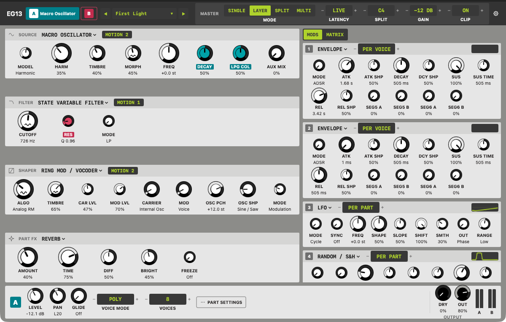

# EG13

EG13 is a free, open-source synthesizer plugin for macOS: a two-part (bi-timbral) instrument, and an audio effect, built on the DSP of the open-source Eurorack firmware by Émilie Gillet ([pichenettes/eurorack](https://github.com/pichenettes/eurorack)). Each engine slot takes one of the modules' sound engines, so a voice can be a modal synth through an analog filter model into a ring modulator, with granular texture after it.



EG13 is not affiliated with or endorsed by Mutable Instruments. "Mutable Instruments" is a registered trademark; EG13 uses its own names for each engine.

## Download

Get the latest version from the [Releases page](https://github.com/SymbioticAudio/EG13/releases). Unzip it and follow `INSTALL.txt`, or the [install guide](docs/manual/install.md).

- **Formats:** AU, VST3 and CLAP. Each holds both plugins: **EG13** (the instrument) and **EG13 FX** (the audio effect).
- **Requirements:** macOS 14 (Sonoma) or later, on Apple silicon or Intel (universal binaries).
- **Unsigned for now:** the release is not yet signed and notarised by Apple, so macOS blocks the plugins until you clear the quarantine once. The install guide shows the two ways to do it.

## What it does

- **Two parts, A and B**, of up to eight voices each, played as one part, layered, split across the keyboard, or on separate MIDI channels.
- **Each voice** runs a Source, a Filter, a Shaper and an Amp. **Each part** has four mod slots (envelope, LFO, random and function generator engines), a 12-route modulation matrix, and a Part FX slot: granular, granular delay, resonator or reverb.
- **Expression:** MPE, mod wheel, aftertouch, four assignable CCs, and tempo sync to the host.
- **Presets:** a new instance opens on **First Light**, a slowly evolving two-part ambient patch. Bank 1 holds 40 presets made for EG13, Bank 2 seven presets rebuilt from a CC BY-licensed VCV Rack patch (the patch, three of its parts and three variations), and EG13 FX has 12 effect presets of its own. Save your own into the User bank and share them as files.
- **EG13 FX** runs the same parts on an audio track, so the filters, ring modulator, granular and reverb engines process any sound. The instrument has no audio input: to process external audio, use EG13 FX on an audio track or bus (you can still play it from MIDI; for Logic Pro's setup, see `docs/manual/install.md`).

The [manual](docs/manual/index.md) covers every engine and setting; [Presets](docs/manual/presets.md) covers the banks and your own presets; [Known limitations](docs/manual/limitations.md) lists what version 1.0 does not do yet.

## Engines

The editor uses its own names; the module each engine is based on is listed for reference.

- **Macro Oscillator** — based on Plaits
- **Digital Oscillator** — based on Braids
- **Modal Synth** — based on Elements
- **Resonator** — based on Rings
- **Audio Input** — EG13 FX's input (or, in the instrument, the other part) through a per-voice gate
- **Analog Filter** — the VCV model of Ripples
- **Classic Filters** — sst-filters (Surge's filters)
- **State Variable Filter** — the SVF from the Eurorack DSP library
- **Ring Mod / Vocoder** — based on Warps
- **EQ** — the VCV model of Shelves
- **Envelope** — based on Stages
- **LFO** — based on Tides 2
- **Random / S&H** — based on Marbles
- **Function Generator** — based on Peaks
- **Granular** (Part FX) — based on Clouds
- **Granular Delay** (Part FX) — based on Beads
- **Resonator** (Part FX) — based on Rings
- **Reverb** (Part FX) — the reverb of Elements

## Building (macOS)

```bash
git clone --recursive https://github.com/SymbioticAudio/EG13.git
cd EG13
brew install cmake ninja
cmake --preset mac
cmake --build --preset mac --target EG13_all eg13_tests
ctest --preset mac
scripts/validate.sh            # clap-validator, auval, out-of-process AU render, pluginval
```

The SwiftUI editor (`ui/EG13UI`) is built into the plugins by default on macOS. It needs
Swift 6.0 or later (developed with 6.4 / Xcode 27.1) and a macOS 14.0 deployment target; the editor's one dependency,
[symbiotic-design](https://github.com/SymbioticAudio/symbiotic-design), is pinned to exactly 0.1.0 and fetched by
SwiftPM on the first build (network needed once). `scripts/build-ui.sh` builds the Swift package
once per architecture and merges them into one static library, which `cmake/eg13_ui.cmake`
links into the plugin. Configure with `-DEG13_BUILD_UI=OFF` to build the plugins without an
editor (hosts then show their generic parameter view); Linux builds never include it.

```bash
swift test --package-path ui/EG13UI                      # the editor's unit tests
swift run --package-path ui/EG13UI EG13UIPreview         # the editor in a plain window over a fake plugin
swift run --package-path ui/EG13UI EG13UIPreview --editor   # straight to the editor page
scripts/check-objc-prefix.sh build/mac/plugins/EG13.clap   # also EG13.vst3 and EG13.component
```

`scripts/check-objc-prefix.sh` fails when a bundle defines an Objective-C class that does not
start with EG13: hosts load many plugins into one process and share one class namespace.
Run it on each of the three built bundles before a release.

A fresh Xcode install needs `sudo xcodebuild -runFirstLaunch` once. `scripts/validate.sh`
installs EG13.component into `~/Library/Audio/Plug-Ins/Components`, restarts
AudioComponentRegistrar and ad-hoc signs the built bundles.

After installing or rebuilding the AU, quit and reopen Logic so it rescans
plugins; if EG13 is still missing, use Logic Pro → Settings → Plug-in Manager →
Reset & Rescan Selection.

EG13 has a **Latency Mode** (Live or Studio; see `docs/manual/latency.md`). The reported latency at 44.1 / 48 / 96 kHz:

| Mode | Plugin | 44.1 kHz | 48 kHz | 96 kHz |
|---|---|---|---|---|
| Live | EG13 | 462 samples (10.48 ms) | 531 samples (11.06 ms) | 798 samples (8.31 ms) |
| Live | EG13 FX | 598 samples (13.56 ms) | 663 samples (13.81 ms) | 1062 samples (11.06 ms) |
| Studio | EG13 | 918 samples (20.82 ms) | 1060 samples (22.08 ms) | 1578 samples (16.44 ms) |
| Studio | EG13 FX | 1194 samples (27.07 ms) | 1330 samples (27.71 ms) | 2118 samples (22.06 ms) |

The Modal Synth's 32 kHz engine, the Ring Mod / Vocoder's 96 kHz engine and the Part FX Granular's 32 kHz engine set it, and every engine is padded to it so changing engines never shifts timing. The Part FX slot takes 263 samples (5.48 ms) in Live and 539 (11.23 ms) in Studio at 48 kHz, whole-block wait included, and every part pays it even with Part FX Off (otherwise switching an effect would move the sound in time). Processed input lines up with Dry in EG13 FX; hosts compensate automatically. In the instrument, note onsets are aligned.

CPU, Apple M1 (base), 48 kHz, 128-sample blocks, 2 × 8 voices, no modulation (5 s per figure; repeats vary by about one point):

- Heaviest mono-source chain: Resonator -> Analog Filter -> Vocoder: 49.46% of one core (budget 50%); Macro Oscillator -> Analog Filter -> Vocoder is within a point (48.96% in the modulation benchmark's run)
- Heaviest stereo chain: Modal Synth -> Analog Filter -> Vocoder: 89.97% of one core (for information; not held to the budget)
- Heaviest mono-source chain with 1 side input in use (Modulator Input): 50.38% of one core
- Heaviest mono-source chain with 2 side inputs in use (Carrier Source AUX, Modulator Input): 51.37% of one core

Modulation, same setup:

- Heaviest mono-source chain (Macro Oscillator), no modulation: 48.96% of one core
- Same with 4 per-voice LFO slots (Frequency outputs) and 12 routes per part: 58.01% of one core
- Modulation at full load: 9.05% of one core (budget 10%; earlier runs measured 7.1 to 7.5 points)
- EG13 init patch: 14.32% of one core; EG13 FX init patch (Granular in Part A): 8.15% (for information)

Part FX, same setup, both parts running the same Part FX setting, the share added over Part FX Off (Macro Oscillator, 2 × 8 voices; Off itself costs only the padding):

- Budget: at most 5% of one core for both parts at their costliest Part FX setting, rate conversion included
- Live: costliest is Granular Delay (Digital, Size 100%) at 2.66%; Granular (Spectral, 16-bit stereo) 2.20%; Resonator (4 voices, costliest Model String + Reverb) 1.84%; Reverb 0.24%
- Studio: costliest is Granular (Spectral, 16-bit stereo) at 2.73%; Granular Delay 2.42%; Resonator 1.87%; Reverb 0.44%
- Heaviest chain with modulation and the costliest Part FX in both parts (Resonator, 4 voices, String + Reverb): 59.94% of one core (for information; the same chain with modulation and Part FX Off: 58.01%)

Memory: a Part with every voice engine takes 6.76 MB constructed plus 3.10 MB when prepared (48 kHz, 512-sample blocks). The Part FX engines add 1.53 MB per Part (8.58 MB for a Part with every Part FX engine against 7.06 MB with Off only); all of it is allocated when the plugin is created or prepared, none while playing.

The 50 % budget applies to the voice chain with a mono Source and no modulation; modulation has its own budget of 10 % of a core with every mod slot of every voice in use, and Part FX has its own of 5 %.

The 50 % budget is met by the heaviest chain with a mono Source while the Ring Mod / Vocoder's Carrier and Modulator are the internal oscillator or the voice, and only just (the figure moves by about a point between runs). With one side input carrying a signal (Source AUX, Input or Other part) the same chain is just over it, and stereo chains of the heaviest engines can use much more. Engines that run at their own sample rate convert a side input only while it carries a signal, and their right channel only while it differs from the left; the result is the same as converting everything.

Editor cost (Apple M1, release build, re-measured for M6b). Main thread: with a static patch and no notes sounding the editor idles at about 0.4% of one core (0.35, 0.35 and 0.40%; budget 5%; CPU time over 20 s starting 6 s after start, in the preview app with `--editor-static`, which runs the same views and tick over a fake plugin whose mods produce nothing; M6a measured 0.25%, the rise is the 15 Hz modulation tick finding nothing to redraw). While modulation moves, the mod traces redraw at 15 Hz: about 3.5 to 4% (`--editor`, whose fake plugin animates every mod slot: 3.55, 3.60 and 3.90%; `--mod-load`, the init patch with a held chord, three modulated knobs and three traces: 4.15, 3.70 and 3.55%; budget 10%). In the plugin a trace stops redrawing two seconds after its voice ends or its output holds still, so the editor returns to idle cost after the last note. While a knob is being dragged the same app used about 13% of one core in M6a (a full-range sweep at 30 edits a second, for information; not re-measured). Audio thread: `UiBridge::drain` with 64 edits waiting for every 128-sample block at 48 kHz takes 2.3 microseconds, 0.084 to 0.087% of the block's real-time budget (budget 0.1%; it was 0.088%). The modulation publish (both parts, 8 voices each, with the per-tick output sampling) costs 0.017 to 0.055% of the block's budget (0.4 to 1.5 microseconds against a 381 microsecond block; budget 0.5%; it was 0.036%). The figures are in `docs/manual/interface.md`.

Plugins are written to `build/mac/plugins`. The first configure downloads the VST3 and
AudioUnit SDKs.

## Building the core on Linux

```bash
cmake --preset linux && cmake --build --preset linux && ctest --preset linux
```

## Credits

- DSP based on the open-source Eurorack firmware by Émilie Gillet (MIT licence).
- Analog Filter and EQ: the Ripples and Shelves models from VCV's AudibleInstruments (© 2020 Tyler Coy and contributors), GPL-3.0-or-later.
- Classic Filters: sst-filters and sst-basic-blocks by the Surge Synth Team, GPL-3.0-or-later.
- Bank 2 presets: a rebuild of "~zero-g:catnap : vcv rack jam" by plantay ([Patchstorage](https://patchstorage.com/zero-gcatnap-vcv-rack-jam/)), CC BY 4.0; see [Presets](docs/manual/presets.md#credits) for what was changed.
- The plugin formats, sample-rate conversion, JSON and the rest: see [THIRD-PARTY-NOTICES.md](THIRD-PARTY-NOTICES.md), which lists every component in the plugins with its copyright and licence.

## Licence

EG13 is free software under the GNU General Public License, version 3 ([LICENSE](LICENSE)). Each release's zip names the tag its source code is at.
